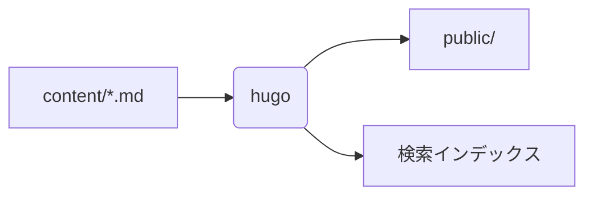

## ノート


補足情報を書きます。



知っておくと便利なことを書きます。



注意が必要なことを書きます。



取り返しがつかない操作の警告を書きます。


Markdown の引用で書く GitHub 式のアラート（`> [!NOTE]` `> [!TIP]` `> [!IMPORTANT]` `> [!WARNING]` `> [!CAUTION]`）も、同じ箱で表示します。`[!NOTE]` の続きに書いた文字は見出しになります。

> [!WARNING]
> 引用の書き方でも、注意の箱になります。

> [!TIP] 見出しを変える
> `[!TIP]` の後ろに書いた文字が見出しです。

## タブ


```bash
brew install hugo
```



```bash
sudo dnf install hugo
```



```powershell
winget install Hugo.Hugo.Extended
```


## 折り畳み

```details {title="設定の全文を表示する"}
折り畳みの中身です。Markdown がそのまま書けます。
```

## 図（Mermaid）

Mermaid 12.0.0 をテーマに同梱しています。図があるページだけローカルから読み込み、オフラインでも表示できます。


